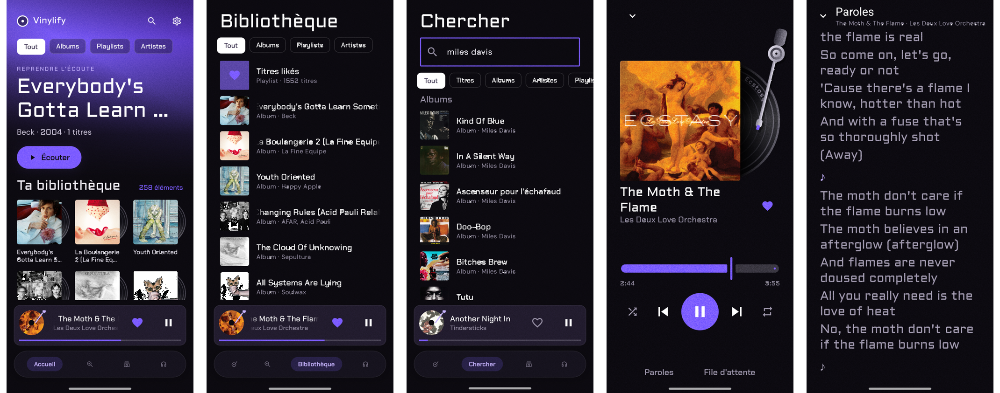

# Vinylify

Une application Android qui transforme ta bibliothèque Spotify en discothèque : une platine vinyle qui tourne, une pochette qui la surplombe, des paroles gravées sur le disque.

> **Direction artistique et code entièrement réalisés en vibecoding.**
> Aucune ligne n'a été écrite à la main : l'identité visuelle (platine, polices, couleurs, animations) comme l'application ont été conçues et codées en dialoguant avec [Claude](https://claude.com/claude-code). Ce dépôt est autant une expérience qu'une application : jusqu'où peut-on aller en décrivant ce qu'on veut, en regardant le résultat sur un vrai téléphone et en corrigeant à la voix.



*Accueil · Bibliothèque · Recherche · Lecteur · Paroles*

## Ce que fait l'application

- **Connexion Spotify** par OAuth PKCE (aucun secret embarqué). La session est conservée, le jeton est chiffré (Tink + Android Keystore).
- **Splash animé** de 4 secondes : la platine du loader se pose, tourne un cycle, puis se fond dans l'écran de connexion ou l'accueil.
- **Accueil** : reprise de l'écoute avec le dernier album enregistré, filtres (Tout, Albums, Playlists, Artistes) et grille de pochettes avec leur disque.
- **Bibliothèque, Recherche** (par titre, album, artiste ou playlist), pages **Album**, **Artiste** et **Playlist**.
- **Lecteur** : une vraie platine. La pochette surplombe le disque, le bras de lecture se pose, le disque tourne et ralentit à l'arrêt. Un balayage de la pochette passe au morceau suivant ou précédent, la platine reste en place. Un tap sur l'artiste ouvre sa page, un tap sur le titre ouvre l'album.
- **Paroles** synchronisées (via [LRCLIB](https://lrclib.net)), affichées en plein écran et **gravées le long d'un sillon du disque** : le texte ne change que lorsqu'il passe derrière la pochette, sans mise à jour en temps réel.
- **Mini-lecteur** persistant, **file d'attente**, favoris, mélange et répétition.
- **Reconnexion automatique** à Spotify au retour au premier plan (Spotify coupe volontiers la liaison en arrière-plan). Si elle échoue, un tap sur le mini-lecteur la relance.
- À la déconnexion, la lecture est mise en pause.

La lecture passe par Spotify App Remote : l'application Spotify doit être installée et un compte **Premium** est requis pour piloter la lecture.

## Direction artistique

Une ambiance de chaîne hi-fi des années 70-80, sombre, avec un accent violet et un grain discret.

| Rôle | Police |
|---|---|
| Titres | Aldrich |
| Libellés, boutons, dock, titres de listes | Chakra Petch |
| Chiffres (durées, compteurs, années) | Aldrich |
| Texte gravé sur le disque | Righteous |
| Corps de texte | DM Sans |

Toutes sont des polices Google Fonts téléchargées à l'exécution (Google Play Services) : aucun fichier de police n'est embarqué. La barre de navigation est une dock flottante dont l'onglet actif n'affiche que son libellé ; ses icônes sont dessinées à la main (disque et bras, loupe-disque, pochettes empilées).

## Technique

- **Kotlin** 2.4, **Jetpack Compose** (Material 3, BOM 2025.12), **Navigation Compose**
- **Hilt** pour l'injection, ViewModels et `StateFlow`
- **[spotify-sdk](https://github.com/vandervdb/spotify-sdk)** : le SDK maison (Kotlin Multiplatform) qui porte l'API Web Spotify, l'authentification, App Remote et les paroles. Publié sur Maven Central (`io.github.vandervdb`), sa version est fixée dans `gradle/libs.versions.toml`
- Tink + Android Keystore pour le chiffrement du jeton
- Android **minSdk 26**, targetSdk 35

Organisation du code (`app/src/main/kotlin/org/vander/android/vinylify`) :

```
designsystem/   thème, couleurs, typographie, composants (platine, disque, loader, dock…)
feature/        un dossier par écran : connection, home, library, search, album, artist,
                playlist, player, lyrics, queue, profile, settings
navigation/     graphe de navigation, dock, transitions
security/       chiffrement du jeton
di/             modules Hilt
```

## Lancer le projet

1. **AAR App Remote.** Télécharge `spotify-app-remote-release-0.8.0.aar` depuis [spotify/android-sdk](https://github.com/spotify/android-sdk/tree/master/app-remote-lib) (Apache-2.0) et place-le dans `app/libs/`. Il n'est pas versionné ici.
2. **Application Spotify.** Crée une app sur le [Spotify Developer Dashboard](https://developer.spotify.com/dashboard) et renseigne :
   - l'URI de redirection `org-vander-androidapp://callback` ;
   - l'Android package `org.vander.android.vinylify` et l'empreinte SHA-1 de **ta** clé de signature (utile à App Remote). En debug, c'est celle du keystore debug de ta machine, propre à chacun :
     ```bash
     keytool -list -v -keystore ~/.android/debug.keystore -alias androiddebugkey -storepass android | grep SHA1
     ```
     Un APK signé par quelqu'un d'autre (une pré-release GitHub, par exemple) porte sa SHA-1 à lui : déclare-la aussi, ou compile toi-même.
   - Tant que l'app est en *Development Mode*, seuls les comptes Spotify ajoutés dans *User Management* peuvent se connecter (le propriétaire de l'app l'est d'office). Chacun peut aussi créer sa propre app et utiliser son client ID.
3. **Client ID.** Fournis-le par variable d'environnement `SPOTIFY_CLIENT_ID`, ou dans `local.properties` :
   ```properties
   CLIENT_ID=ton_client_id
   ```
   Il n'est jamais commité. Il n'y a pas de client secret : le SDK utilise PKCE.
4. **Compiler et installer** :
   ```bash
   ./gradlew :app:installDebug
   ```

Tests unitaires : `./gradlew :app:testDebugUnitTest`.

## CI / CD

- **CI** (`.github/workflows/ci.yml`) : à chaque push sur `main` et chaque pull request, récupère l'AAR App Remote, lance les tests unitaires et compile les variantes debug et release (R8 et lint compris). L'APK debug est joint au run.
- **CD** (`.github/workflows/release.yml`) : pousser un tag `v*` dans ce dépôt (par exemple `git tag v0.2.0 && git push --tags` ; sans lien avec les versions de spotify-sdk) construit l'APK et crée une release GitHub. Sans clé de signature, il s'agit d'un APK debug publié en pré-release. Pour une release signée, ajoute les secrets `KEYSTORE_BASE64`, `KEYSTORE_PASSWORD`, `KEY_ALIAS` et `KEY_PASSWORD`, et `SPOTIFY_CLIENT_ID` pour que l'APK contienne ton client ID.

## Licence

[MIT](LICENSE)
